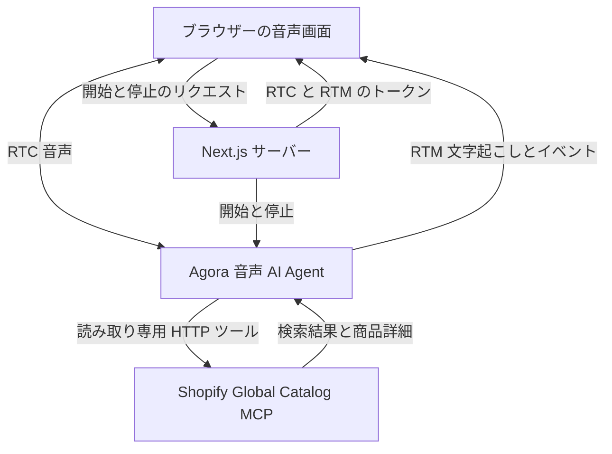

# Agora 音声ショッピングアシスタント デモ

[English](README.md) | [简体中文](README.zh-CN.md) | [日本語](README.ja.md)

この文書のみを日本語に翻訳しています。アプリの画面と音声会話は英語です。以下の発話例は英語で話してください。日本語訳は意味を確認するためのものです。

Agora Conversational AI を使った音声ショッピングアシスタントのデモです。Shopify ストアを横断して商品を検索、比較できます。

**[デモを試す →](https://agora-voice-shopping-assistant-demo.vercel.app)**

**[Agora Recipes で音声 AI デモをもっと探す →](https://recipes.agora.io/)**

[](https://www.agora.io/en/products/conversational-ai-engine/)
[](https://nextjs.org/docs)
[](https://shopify.dev/docs/agents/catalog/global-catalog)
[](LICENSE)

[機能](#features) · [技術構成](#tech-stack) · [ローカル実行](#run-locally) · [Vercel へのデプロイ](#deploy-to-vercel) · [使い方](#how-it-works) · [カスタマイズ](#customize) · [よくある質問](#faq) · [関連リンク](#more)

<a id="what-you-can-do"></a>

<a id="features"></a>

## 機能

- **音声検索：** 欲しいものを説明して商品を探せます。
- **市場の選択：** 配送先の国と希望通貨に合わせて検索します。
- **予算に応じた比較：** 任意の予算内で商品を比較します。
- **商品詳細：** 価格、販売状況、バリエーション、販売元を確認できます。
- **追加質問と文字起こし：** 条件を変更し、リアルタイムのテキストを確認できます。

<a id="tech-stack"></a>

## 技術構成

- **フロントエンド：**  Next.js、React、TypeScript。
- **音声 AI：**  Agora Conversational AI、Agents SDK、RTC、RTM。
- **モデル：**  Deepgram STT、OpenAI LLM、MiniMax TTS。
- **商品データ：** 読み取り専用ツールから Shopify Global Catalog にアクセスします。

<a id="quick-start"></a>

<a id="run-it"></a>

<a id="try-it"></a>

<a id="conversation"></a>

## はじめに

<a id="run-locally"></a>

### ローカル実行

Node.js 24、pnpm 9.15.9、Conversational AI を有効にした [Agora プロジェクト](https://console.agora.io/)が必要です。

**1. インストールと設定**

このリポジトリをクローンまたはダウンロードし、そのディレクトリでターミナルを開きます。

```bash
pnpm install --frozen-lockfile

if [ ! -f .env.local ]; then
  cp env.local.example .env.local
fi
```

[Agora Console](https://console.agora.io/) でプロジェクトを作成または選択します。**Manage credentials** を開き、**App ID** と **Primary certificate** を `.env.local` にコピーします（[手順](https://docs.agora.io/en/introduction/console-setup)）。

```dotenv
NEXT_PUBLIC_AGORA_APP_ID=your_agora_app_id
NEXT_AGORA_APP_CERTIFICATE=your_agora_app_certificate
```

デフォルトの音声・言語モデルには別途 API キーは不要です。App Certificate はサーバー専用です。`.env.local` に保存し、ブラウザーのコードに公開しないでください。設定例は [env.local.example](env.local.example) を参照してください。

Shopify の任意設定は [env.local.example](env.local.example) を参照してください。

**2. アプリを起動**

```bash
pnpm run doctor
pnpm run dev
```

[http://localhost:3000](http://localhost:3000) を開き、**Start voice shopping** を選んでマイクの使用を許可します。必要に応じて要約を依頼し、終了ボタン（**End session**）で通話を終えます。

各セッションは10分後に自動終了します。続けるには Start again を選択してください。

<a id="deployment"></a>

<a id="deploy-to-vercel"></a>

### Vercel へのデプロイ

[](https://vercel.com/new/clone?repository-url=https%3A%2F%2Fgithub.com%2FAgoraIO-Community%2Fagora-voice-shopping-assistant-demo&env=NEXT_PUBLIC_AGORA_APP_ID%2CNEXT_AGORA_APP_CERTIFICATE&envDescription=Agora%20App%20ID%20and%20App%20Certificate%20from%20Agora%20Console.%20Enable%20Conversational%20AI%20for%20the%20project.&envLink=https%3A%2F%2Fdocs.agora.io%2Fen%2Fintroduction%2Fconsole-setup&project-name=agora-voice-shopping-assistant-demo&repository-name=agora-voice-shopping-assistant-demo)

1. ボタンからリポジトリを自分の Git アカウントにクローンし、Vercel に取り込みます。
2. **Next.js** と Node.js 24 を選びます。
3. **Environment Variables** で `NEXT_PUBLIC_AGORA_APP_ID` と `NEXT_AGORA_APP_CERTIFICATE` を設定してデプロイします。

<a id="how-it-works"></a>

## 使い方

1. **買い物を開始：**  **Start voice shopping** を選び、マイクの使用を許可します。
2. **希望を説明：** 商品、配送先の国、通貨、任意の予算を伝えます。
3. **商品を比較：** Agent が Shopify を検索し、詳細を確認して候補を提案します。
4. **検索を調整：** 追加質問、条件変更、会話終了ができます。

### アーキテクチャ



Next.js がブラウザー用トークンを発行し、Agora Agent を起動します。Agent は会話中に Shopify の商品を検索します。詳細は [ARCHITECTURE.md](ARCHITECTURE.md) を参照してください。

<a id="faq-and-limitations"></a>

<a id="faq"></a>

## よくある質問

### Shopify ストアや API キーは必要ですか？

デモを試す際は不要です。本番利用は [Shopify の認証ガイド](https://shopify.dev/docs/agents/get-started/authentication)を参照してください。

### 何を質問できますか？

例：「Find trail running shoes for delivery to the UK under 150 British pounds.」（訳：「英国に配送できる150ポンド以下のトレイルランニングシューズを探して。」）続けて「My budget is now 100 British pounds. Can you find another option?」（訳：「予算を100ポンドに変えます。他にありますか？」）と尋ねます。

### おすすめ商品はどこから取得しますか？

Shopify Global Catalog から現在の販売情報を取得します。詳細と最終価格は販売元のサイトで確認し、購入も販売元のサイトで行います。

### 希望する商品が見つからないのはなぜですか？

検索語、配送先の国、通貨、予算によって結果が異なります。語句や予算を変えてください。レート制限の場合は時間をおいて再試行してください。

### 音声セッションを開始できないのはなぜですか？

ブラウザーのマイク権限、入力機器、Agora App ID、App Certificate、Conversational AI の利用権限を確認します。localhost または HTTPS を使ってください。`pnpm run doctor` でローカル設定を確認し、画面のエラーに従って再試行します。

### 会話のコピーを保存できますか？

はい。Inspector で **Export session evidence** を選び、現在または直前の通話を JSON でダウンロードできます。次の通話やページ更新の前にエクスポートしてください。

<a id="customize"></a>

### 実際の業務に近づけるにはどうしますか？

[RAG](https://docs.agora.io/en/ai/build/custom-model-integration/custom-llm)、[ツール呼び出し](https://docs.agora.io/en/ai/build/tools/custom-tools)、[MCP](https://docs.agora.io/en/ai/build/tools/mcp-tools) で独自のナレッジベースや業務サービスに接続します。

### 自分の用途に合わせるにはどうしますか？

用途に合わせて Agent のプロンプト、業務ツール、インターフェースを変更します。

## ライセンスと出典

[MIT License](LICENSE) の下で公開しています。[第三者の権利表記](THIRD_PARTY_NOTICES.md)を保持してください。 商品データ：[Shopify Global Catalog](https://shopify.dev/docs/agents/catalog/global-catalog)。

<a id="more"></a>

## 関連リンク

- **[Recipes](https://recipes.agora.io/)：** Agora のデモや連携例を探せます。
- **[Docs](https://docs.agora.io/en/ai)：** 音声 Agent の構築と拡張を学べます。
- **[Console](https://console.agora.io/)：** プロジェクト、認証情報、使用量を管理します。
