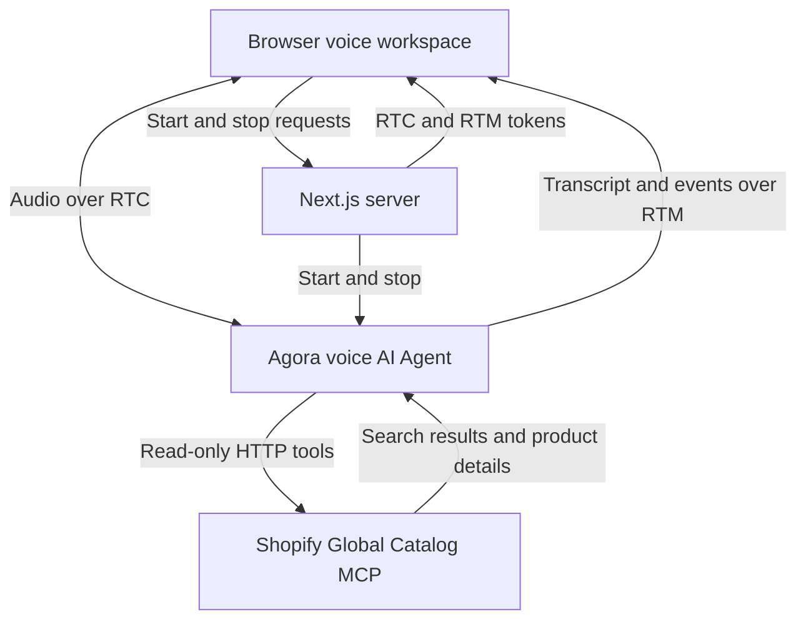

# Agora Voice Shopping Assistant Demo

A voice shopping assistant demo for searching and comparing products across Shopify stores, built with Agora Conversational AI.

**[Explore more voice AI demos on Agora Recipes →](https://recipes.agora.io/)**

[](https://www.agora.io/en/products/conversational-ai-engine/)
[](https://nextjs.org/docs)
[](https://shopify.dev/docs/agents/catalog/global-catalog)
[](LICENSE)

[Features](#features) · [Tech stack](#tech-stack) · [Run locally](#run-locally) · [Deploy to Vercel](#deploy-to-vercel) · [How it works](#how-it-works) · [Customize](#customize) · [FAQ](#faq) · [More](#more)

<!-- Recipes URL: add the published Agora Recipes page URL here. -->
<!-- Video: add a recording of product search and comparison here. -->

<a id="what-you-can-do"></a>

## Features

- **Search by voice:** find products by describing what you need.
- **Choose your market:** search for your delivery country and preferred currency.
- **Budget-aware comparisons:** compare products within an optional budget.
- **Product details:** ask about prices, availability, variants, and sellers.
- **Follow-up conversation and transcript:** change your requirements and follow the live transcript.

## Tech Stack

- **Frontend:** Next.js, React, TypeScript.
- **Voice:** Agora Conversational AI and Agents SDK, with RTC audio and RTM transcripts.
- **Models:** Deepgram STT, OpenAI LLM, MiniMax TTS.
- **Product data:** Shopify Global Catalog through read-only tools.

<a id="quick-start"></a>
<a id="run-it"></a>
<a id="try-it"></a>

## Getting Started

### Run Locally

You need Node.js 24, pnpm 9.15.9, and an [Agora project](https://console.agora.io/) with Conversational AI enabled.

**1. Install and configure**

Clone or download this repository, then open a terminal in its directory.

```bash
pnpm install --frozen-lockfile

if [ ! -f .env.local ]; then
  cp env.local.example .env.local
fi
```

Create or select a project in [Agora Console](https://console.agora.io/). Open **Manage credentials** and copy its **App ID** and **Primary certificate** into `.env.local` ([instructions](https://docs.agora.io/en/introduction/console-setup)):

```dotenv
NEXT_PUBLIC_AGORA_APP_ID=your_agora_app_id
NEXT_AGORA_APP_CERTIFICATE=your_agora_app_certificate
```

The default models need no separate provider API keys. Keep the App Certificate server-only. Optional Shopify settings are listed in [env.local.example](env.local.example).

**2. Start the app**

```bash
pnpm run doctor
pnpm run dev
```

Open [localhost:3000](http://localhost:3000), choose **Start voice shopping**, and allow microphone access. Use **End session** to finish.

<a id="deployment"></a>

### Deploy to Vercel

[](https://vercel.com/new)

1. Import this repository into Vercel.
2. Select **Next.js** and Node.js 24.
3. Add `NEXT_PUBLIC_AGORA_APP_ID` and `NEXT_AGORA_APP_CERTIFICATE` under **Environment Variables**, then deploy.

## How It Works

1. **Start shopping:** Choose **Start voice shopping** and allow microphone access.
2. **Describe your request:** Share what you need, your delivery country, currency, and optional budget.
3. **Compare products:** The Agent searches Shopify and checks product details to recommend options.
4. **Refine your search:** Ask follow-up questions, change your requirements, or end the session.

### Architecture



Next.js issues browser tokens and starts the Agora Agent. The Agent queries Shopify for products during the conversation. See [ARCHITECTURE.md](ARCHITECTURE.md) for details.

<a id="faq-and-limitations"></a>

## FAQ

### Do I need a Shopify store or API key?

No, you can try the demo without them. For production use, see [Shopify’s authentication guide](https://shopify.dev/docs/agents/get-started/authentication).

### What can I ask the assistant?

Try “Find trail running shoes for delivery to the UK under 150 British pounds,” then “My budget is now 100 British pounds. Can you find another option?”

### Where do the product recommendations come from?

Shopify Global Catalog supplies current merchant listings. Confirm product details and final prices on the merchant website, where you complete the purchase.

### Why can’t I start a voice session?

Check microphone permission, your Agora credentials, and Conversational AI access. Run `pnpm run doctor` and follow the error shown on the page.

### Why can’t the assistant find products for my request?

Offers depend on your search, delivery country, currency, and budget. Try different terms or adjust the budget. If the service reports a rate limit, retry later.

### Can I save a copy of the conversation?

In Inspector, select **Export session evidence** to download JSON. Export before starting another call or refreshing the page.

<a id="customize"></a>

### How do I make this demo more realistic?

Connect your own knowledge base and business services using [RAG](https://docs.agora.io/en/ai/build/custom-model-integration/custom-llm), [tool calling](https://docs.agora.io/en/ai/build/tools/custom-tools), or [MCP](https://docs.agora.io/en/ai/build/tools/mcp-tools).

### How do I adapt this demo to my own use case?

Customize the agent’s prompt, business tools, and interface for your scenario.

## License and Attribution

[MIT License](LICENSE). Product data: [Shopify Global Catalog](https://shopify.dev/docs/agents/catalog/global-catalog). See [third-party notices](THIRD_PARTY_NOTICES.md).

## More

- **[Recipes](https://recipes.agora.io/):** Explore more Agora demos and integrations.
- **[Docs](https://docs.agora.io/en/ai):** Learn how to build and extend voice agents.
- **[Console](https://console.agora.io/):** Create projects and manage credentials and usage.
