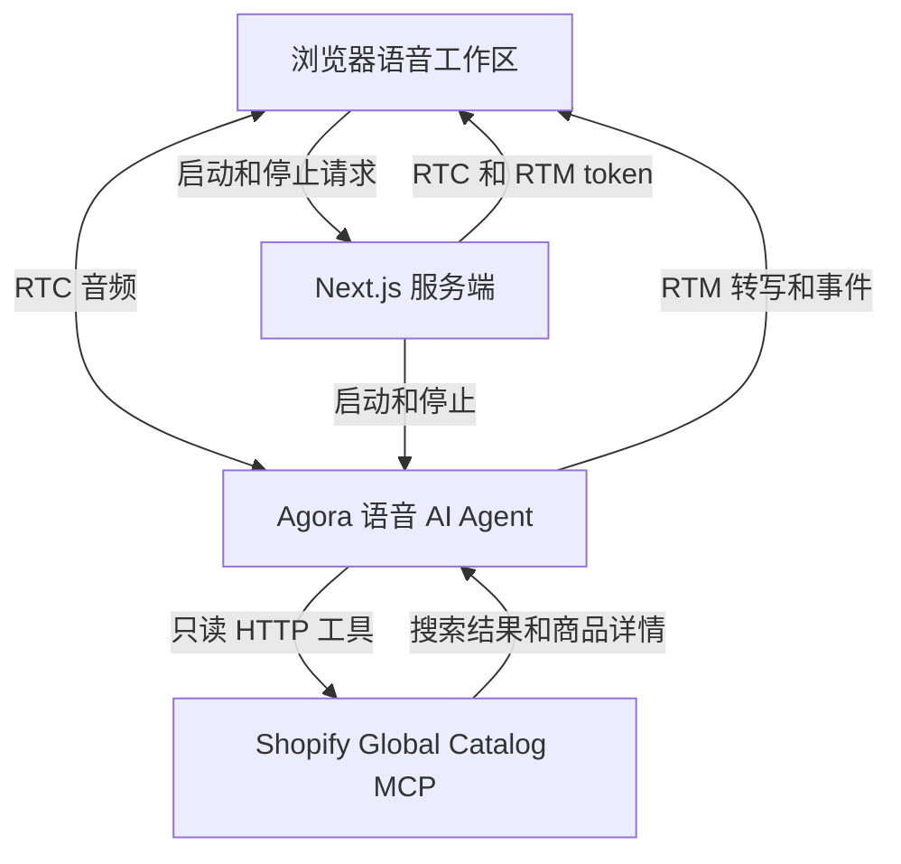

# Agora 语音购物助手演示

[English](README.md) | [简体中文](README.zh-CN.md) | [日本語](README.ja.md)

基于 Agora Conversational AI 的语音购物助手演示，可跨 Shopify 商店搜索和比较商品。

**[在 Agora Recipes 探索更多语音 AI 演示 →](https://recipes.agora.io/)**

[](https://www.agora.io/en/products/conversational-ai-engine/)
[](https://nextjs.org/docs)
[](https://shopify.dev/docs/agents/catalog/global-catalog)
[](LICENSE)

[功能](#features) · [技术栈](#tech-stack) · [本地运行](#run-locally) · [部署到 Vercel](#deploy-to-vercel) · [使用流程](#how-it-works) · [定制](#customize) · [常见问题](#faq) · [更多](#more)

<a id="what-you-can-do"></a>

<a id="features"></a>

## 功能

- **语音搜索：** 描述需求来查找商品。
- **市场选择：** 按配送国家和偏好币种搜索。
- **预算比较：** 在可选预算内比较商品。
- **商品详情：** 询问价格、可售情况、规格选项和商家。
- **追问与转写：** 调整需求并查看实时文字记录。

<a id="tech-stack"></a>

## 技术栈

- **前端：**  Next.js、React、TypeScript。
- **语音 AI：**  Agora Conversational AI、Agents SDK、RTC、RTM。
- **模型：**  Deepgram STT、OpenAI LLM、MiniMax TTS。
- **商品数据：** 通过只读工具访问 Shopify Global Catalog。

<a id="quick-start"></a>

<a id="run-it"></a>

<a id="try-it"></a>

<a id="conversation"></a>

## 快速开始

<a id="run-locally"></a>

### 本地运行

需要 Node.js 24、pnpm 9.15.9，以及已启用 Conversational AI 的 [Agora 项目](https://console.agora.io/)。

**1. 安装与配置**

克隆或下载本仓库，然后在仓库目录中打开终端。

```bash
pnpm install --frozen-lockfile

if [ ! -f .env.local ]; then
  cp env.local.example .env.local
fi
```

在 [Agora Console](https://console.agora.io/) 创建或选择项目。打开 **Manage credentials**，将 **App ID** 和 **Primary certificate** 复制到 `.env.local`（[操作说明](https://docs.agora.io/en/introduction/console-setup)）：

```dotenv
NEXT_PUBLIC_AGORA_APP_ID=your_agora_app_id
NEXT_AGORA_APP_CERTIFICATE=your_agora_app_certificate
```

默认语音和语言模型无需单独配置 API Key。App Certificate 仅限服务端使用，请保存在 `.env.local`，不要暴露在浏览器代码中。配置模板见 [env.local.example](env.local.example)。

Shopify 可选配置见 [env.local.example](env.local.example)。

**2. 启动应用**

```bash
pnpm run doctor
pnpm run dev
```

打开 [http://localhost:3000](http://localhost:3000)，选择 **Start voice shopping** 并允许使用麦克风。需要时可请助手总结对话，点击挂断按钮（**End session**）结束。

<a id="deployment"></a>

<a id="deploy-to-vercel"></a>

### 部署到 Vercel

[](https://vercel.com/new/clone?repository-url=https%3A%2F%2Fgithub.com%2FAgoraIO-Community%2Fagora-voice-shopping-assistant-demo&env=NEXT_PUBLIC_AGORA_APP_ID%2CNEXT_AGORA_APP_CERTIFICATE&envDescription=Agora%20App%20ID%20and%20App%20Certificate%20from%20Agora%20Console.%20Enable%20Conversational%20AI%20for%20the%20project.&envLink=https%3A%2F%2Fdocs.agora.io%2Fen%2Fintroduction%2Fconsole-setup&project-name=agora-voice-shopping-assistant-demo&repository-name=agora-voice-shopping-assistant-demo)

1. 点击按钮，将本仓库克隆到你的 Git 账户并导入 Vercel。
2. 选择 **Next.js** 和 Node.js 24。
3. 在 **Environment Variables** 中填写 `NEXT_PUBLIC_AGORA_APP_ID` 和 `NEXT_AGORA_APP_CERTIFICATE`，然后部署。

<a id="how-it-works"></a>

## 使用流程

1. **开始购物：** 选择 **Start voice shopping** 并允许使用麦克风。
2. **描述需求：** 说明商品、配送国家、币种和可选预算。
3. **比较商品：** Agent 搜索 Shopify 并查询商品详情以推荐选项。
4. **调整搜索：** 继续追问、修改要求或结束会话。

### 架构



Next.js 签发浏览器 token 并启动 Agora Agent。Agent 在对话中查询 Shopify 商品信息。详见 [ARCHITECTURE.md](ARCHITECTURE.md)。

<a id="faq-and-limitations"></a>

<a id="faq"></a>

## 常见问题

### 需要 Shopify 商店或 API Key 吗？

体验演示不需要。生产使用请参阅 [Shopify 认证指南](https://shopify.dev/docs/agents/get-started/authentication)。

### 可以问助手什么？

可以说：“找配送到英国、150 英镑以内的越野跑鞋”，再说“预算改成 100 英镑，还有其他选项吗？”

### 商品推荐来自哪里？

Shopify Global Catalog 提供当前商家商品信息。请在商家网站核对商品详情和最终价格，并在商家网站完成购买。

### 为什么找不到符合要求的商品？

结果取决于搜索词、配送国家、币种和预算。可换关键词或调整预算；服务提示限流时请稍后重试。

### 为什么无法启动语音会话？

检查浏览器麦克风权限、输入设备、Agora App ID、App Certificate 和 Conversational AI 权限。请使用 localhost 或 HTTPS。运行 `pnpm run doctor` 检查本地配置，再按页面错误提示重试。

### 可以保存对话副本吗？

可以。在 Inspector 中选择 **Export session evidence**，将当前或最近一次通话下载为 JSON。请在开始新通话或刷新页面前导出。

<a id="customize"></a>

### 如何让演示更贴近真实业务？

通过 [RAG](https://docs.agora.io/en/ai/build/custom-model-integration/custom-llm)、[工具调用](https://docs.agora.io/en/ai/build/tools/custom-tools)或 [MCP](https://docs.agora.io/en/ai/build/tools/mcp-tools) 连接自己的知识库和业务服务。

### 如何适配自己的场景？

按你的场景定制 Agent 提示词、业务工具和界面。

## 许可与来源

采用 [MIT License](LICENSE)。请保留[第三方声明](THIRD_PARTY_NOTICES.md)。 商品数据：[Shopify Global Catalog](https://shopify.dev/docs/agents/catalog/global-catalog)。

<a id="more"></a>

## 更多

- **[Recipes](https://recipes.agora.io/)：** 探索更多 Agora 演示与集成。
- **[Docs](https://docs.agora.io/en/ai)：** 学习构建和扩展语音 Agent。
- **[Console](https://console.agora.io/)：** 创建项目，管理凭据和用量。
